# Real Estate Investment Advisor

### Relative Property Affordability and Future-Value Scenarios

An end-to-end Python, Machine Learning, and Streamlit project for exploring residential property data, classifying relative affordability, tracking model experiments with MLflow, and calculating assumption-based future property values.

 **Privacy Notice:** The internship-provided dataset, processed datasets, trained model, and MLflow artifacts are not included in this public repository. The public application uses generated illustrative demo data when those private files are unavailable.

## 1. Project Overview

This project demonstrates an end-to-end data science and machine learning workflow:

- Inspecting and preprocessing residential property data.

- Performing Exploratory Data Analysis (EDA).

- Engineering features for relative-affordability classification.

- Training and evaluating a Random Forest classifier.

- Tracking experiments using MLflow.

- Exploring future property-price scenarios using configurable appreciation assumptions.

- Building an interactive Streamlit application.

**Important:** The classification target represents relative affordability within a city. It is not a measure of verified investment profitability.

---

## 2. Application Features

| Application Page | Description |
|---|---|
| Home | Project overview and dataset summary |
| Property Investment | Relative-affordability assessment |
| Price Forecast | Compound-growth scenario calculator |
| Analytics Dashboard | City, property-type, and price-distribution charts |

---

## 3. Application Screenshots

The Streamlit application provides four main sections for exploring property data and affordability scenarios.

### Home Page

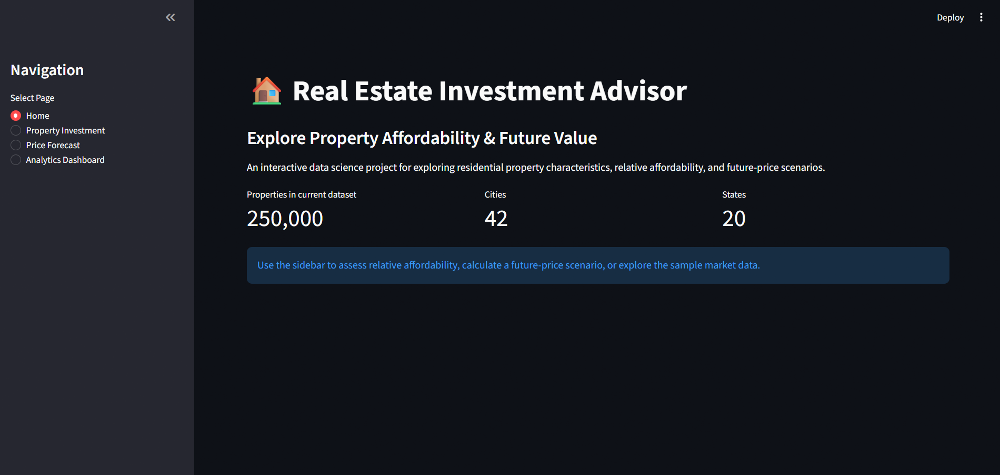

### Property Investment Analysis

Property inputs and relative-affordability assessment using the trained Random Forest model in the private local environment.

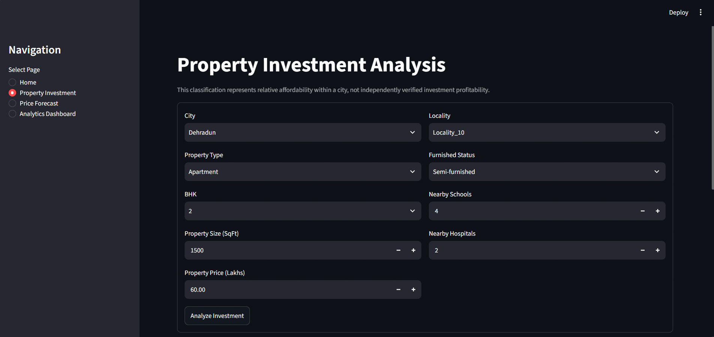

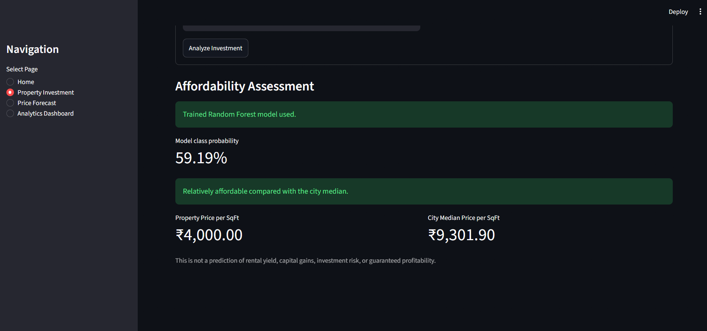

### Price Forecast Scenario

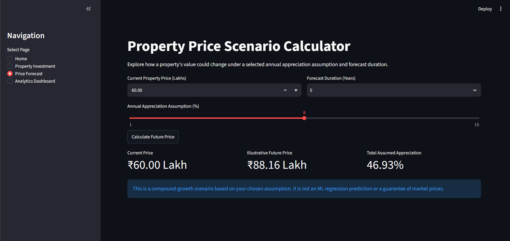

---

## 4. Analytics Dashboard

### Average Property Price by City

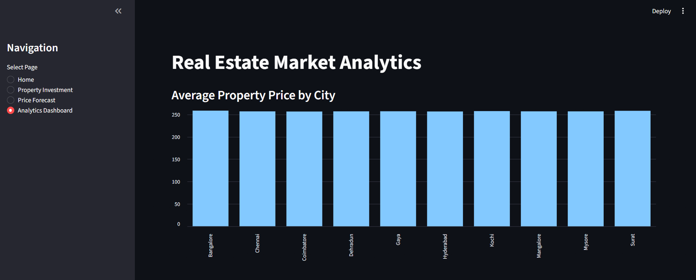

### Property Price Distribution

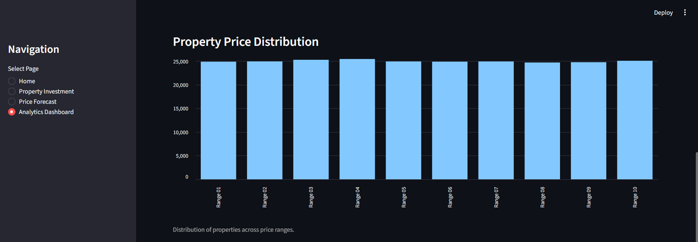

### Property Type Distribution

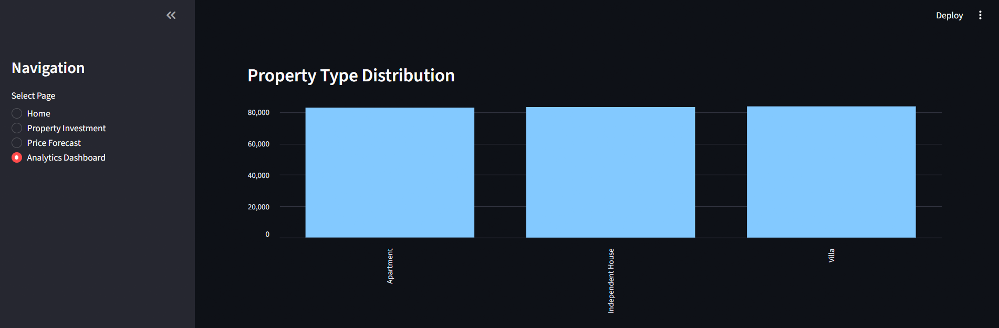

### Dataset Preview

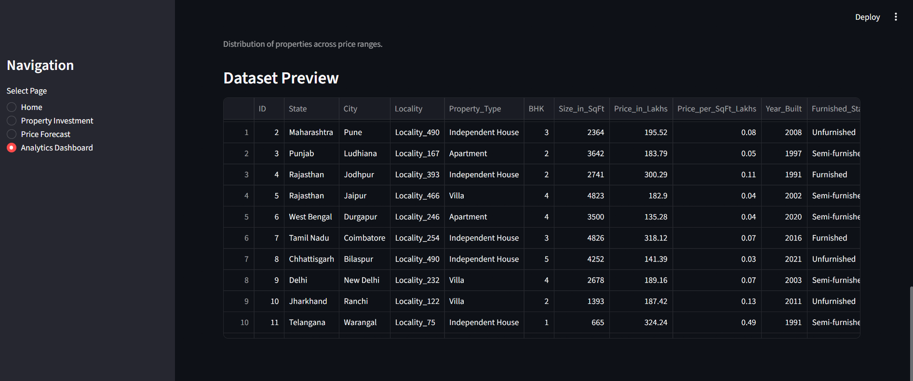

---

## 5. Project Workflow
```text
Internship-provided property data (private)
                 |
                 v
          Data inspection
                 |
                 v
           Quality checks
                 |
                 v
            Preprocessing
                 |
                 v
      Exploratory Data Analysis
                 |
                 v
         Feature engineering
                 |
                 v
        Train/test split (80/20)
                 |
                 v
       Random Forest classifier
                 |
                 v
          Model evaluation
                 |
                 v
       MLflow experiment tracking
                 |
                 v
         Saved model (private)
                 |
                 v
        Streamlit application
```

---
## 6. Exploratory Data Analysis (EDA)

Exploratory Data Analysis was performed to understand property price distributions, property sizes, property categories, and relationships between numerical features.

### Property Price Distribution

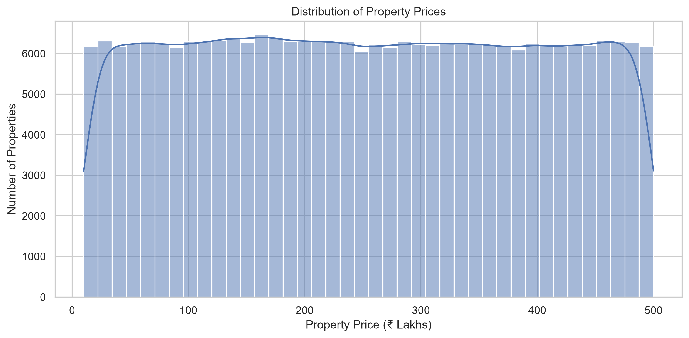

### Property Size Distribution

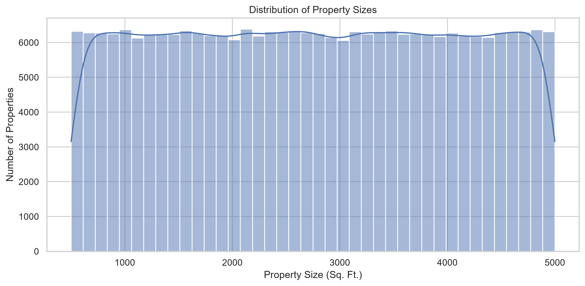

### Average Price by Property Type

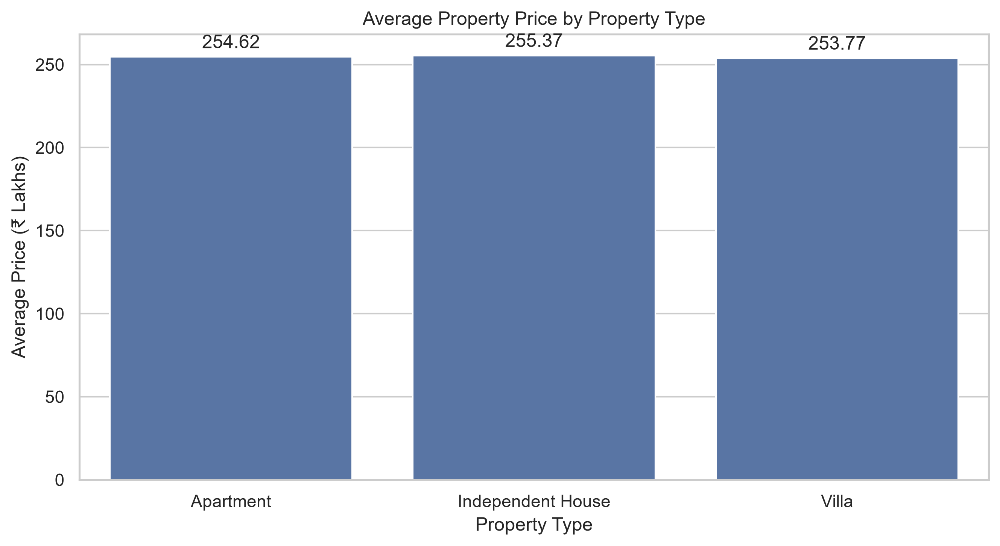

### Property Size vs Price

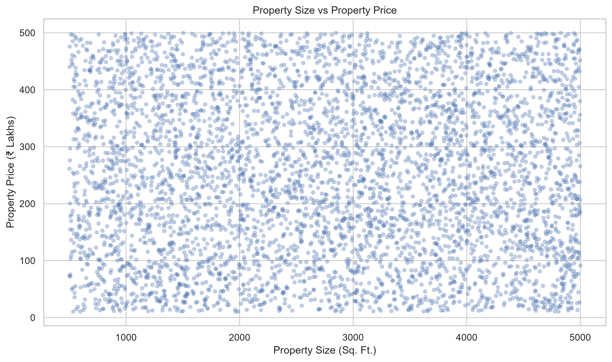

### Feature Correlation Heatmap

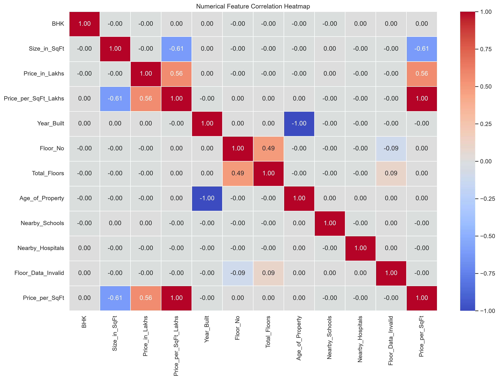

---

## 7. Machine Learning Approach

### Target:  Relative Affordability

The binary target is derived by comparing a property's price per square foot with the median price per square foot in its city.

- **1 - Relatively Affordable:** Price per square foot is at or below the city median.

- **0 - Relatively Expensive:** Price per square foot is above the city median.

> This target is a relative-affordability proxy. It does not directly measure rental yield, capital gains, investment risk, liquidity, or realized returns.

### Random Forest Configuration

| Parameter | Value |
|---|---|
| Algorithm  |  Random Forest Classifier |
| Number of estimators  |  100 |
| Maximum depth  | 15 |
| Minimum samples split | 10 |
| Random state | 42 |
| Class weight | Balanced |
| Training/test split | 80% / 20% |

> The training pipeline uses numerical imputation, categorical encoding, and a ColumnTransformer.

---

## 8. Model Evaluation

The following results are from the private training experiment on 250,000 internship-provided records.

**Training records: 200,000**

**Testing records: 50,000**

These results are from the private training experiment, not the generated public demo data.

### Evaluation Metrics

| Metric | Result |
|---|---:|
| Accuracy | 84.07% |
| Precision | 84.48% |
| Recall | 83.47% |
| F1-score | 83.97% |
| ROC-AUC | 95.65% |

### Confusion Matrix

| Actual Class | Predicted Negative | Predicted Positive |
|---|---:|---:|
| Actual Negative | 21,164 | 3,833 |
| Actual Positive | 4,133 | 20,870 |

**Evaluation Note:** These metrics evaluate the constructed relative-affordability label. They should not be interpreted as evidence of investment returns or future-price prediction accuracy.

---

## 9.MLflow Experiment Tracking

MLflow was used in the private training environment to track the Random Forest classification experiment.

**Experiment Name:** Real_Estate_Investment_Advisor

### MLflow recorded:

- Model parameters
- Evaluation metrics
- Training and testing record counts
- Trained model artifact
- Experiment description

### Experiment Configuration

| Parameter | Value |
|---|---|
| Algorithm | Random Forest Classifier |
| Training records | 200,000 |
| Testing records | 50,000 |
| Number of estimators | 100 |
| Maximum depth | 15 |
| Minimum samples split | 10 |
| Class weight | Balanced |
| Random state | 42 |

> The local `mlruns/` directory and trained model artifact are excluded from this public repository.

> An interviewer can be provided with an appropriately sanitized experiment export or authorized access separately.

---

## 10. ML Flow Experiment Screenshots

### MLflow Experiment Overview

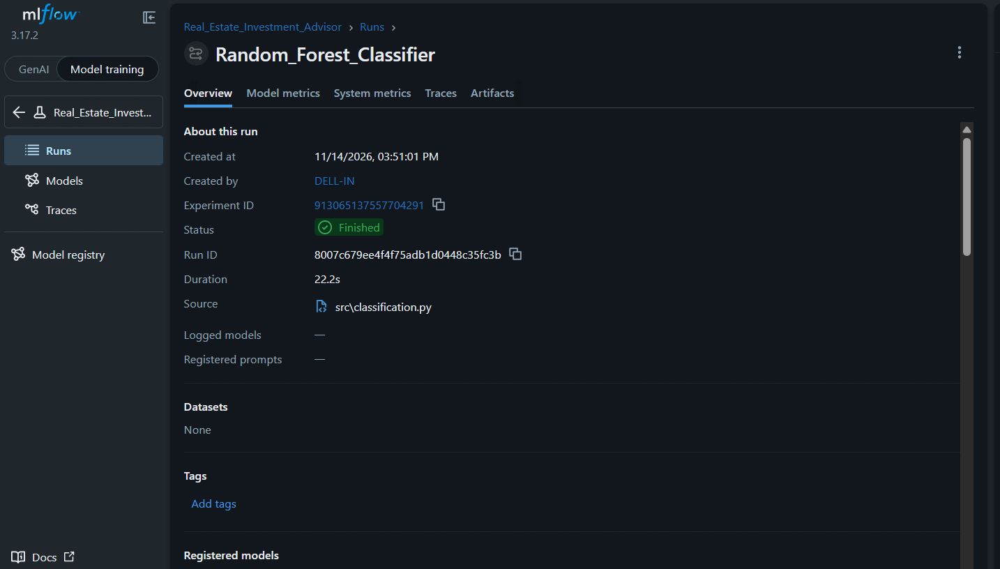

### MLflow Run Metrics

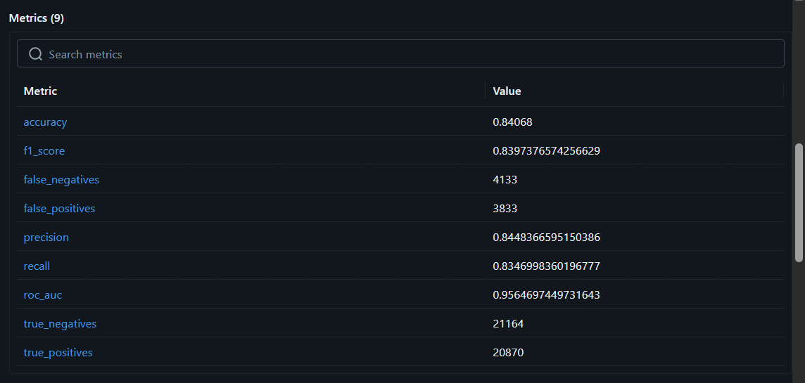

### MLflow Run Parameters

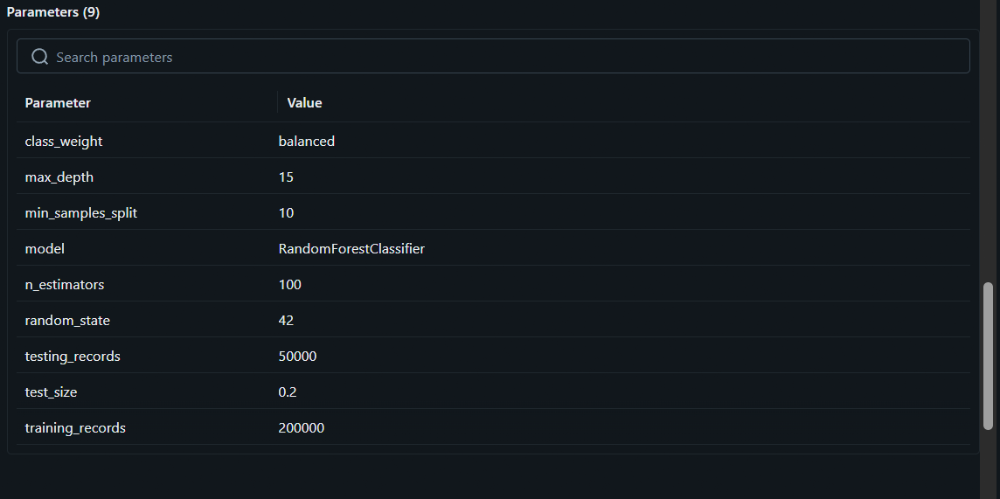

---

## 11. Public Demo vs. Private Training Environment

### 11.1 Public Demo Mode

When the private dataset and model files are unavailable, the application:

- Generates **420 illustrative sample property records** across 8 example cities and states.
- Displays a notice explaining that the records are generated for demonstration.
- Uses a transparent city-median price-per-square-foot baseline for affordability assessment.
- Clearly states that no trained Random Forest model was loaded.
- Keeps the price scenario calculator and analytics dashboard available.

> The generated demo records are not actual market observations and are not copied from the internship dataset.


### 11.2 Private Local Mode

In the authorized local environment, the application can load:

**Processed dataset:**

`data/processed/feature_engineered_data.csv`

**Trained model:**

`models/classification_model.pkl`

These files are deliberately excluded from GitHub.

> **Data Privacy:** Do not upload or redistribute internship-provided data or model artifacts without the data owner's permission.

---

## 12. Project Structure

The public repository contains the following files and directories:

```text
REAL_ESTATE_ADVERTISEMENT_ADVISOR/
│
├── src/
│   ├── inspect_data.py
│   ├── data_quality_checks.py
│   ├── preprocess_data.py
│   ├── eda.py
│   ├── feature_engineering.py
│   ├── classification.py
│   └── regression.py
│
├── reports/
│   └── figures/
│       ├── correlation_heatmap.png
│       ├── price_distribution.png
│       ├── property_type.png
│       ├── size_distribution.png
│       └── size_vs_price.png
│
├── screenshots/
│   ├── analytics/
│   │   ├── analytics_dashboard_average_property_price_by_city.png
│   │   ├── analytics_dashboard_dataset_preview.png
│   │   ├── analytics_dashboard_property_price_distribution.png
│   │   └── analytics_dashboard_property_type_distribution.png
│   │
│   ├── mlflow/
│   │   ├── experiments_overview.png
│   │   ├── run_metrics.png
│   │   └── run_parameters.png
│   │
│   ├── homepage.png
│   ├── price_forecast.png
│   ├── property_investment_1.png
│   └── property_investment_2.png
│
├── app.py
├── requirements.txt
├── README.md
└── .gitignore
```
## Private Local-Only Directories

The following directories are intentionally excluded from the public repository:

`data/`
`models/`
`mlruns/`
`.venv/`

> Private local-only directories such as data/, models/, and mlruns/ are excluded from the public repository.

---

## 13. Installation and Usage

### Requirements

Make sure the following tools are installed:

- Python 3.13
- Git
- pip

### Step 1: Clone the Repository

```bash
git clone https://github.com/rishabhsharma6022002-blip/real-estate-investment-advisor.git
```
Navigate to the project directory:

```bash
cd real-estate-investment-advisor
```

### Step 2: Create a Virtual Environment

```bash
python -m venv .venv
```

### Step 3: Activate the Environment

**Windows PowerShell:**

```powershell
.\.venv\Scripts\Activate.ps1
```

> If PowerShell blocks activation, use the environment's Python executable directly.

### Step 4: Install Dependencies

```bash
pip install -r requirements.txt
```

### Step 5: Run the Application

```bash
python -m streamlit run app.py
```

Open the local URL printed in the terminal, usually:

`http://localhost:8501`

> A fresh clone should start in public demo mode because the private dataset and model files are not included.

---

## 14. Future Improvements

- Validate the approach using independently sourced, authorized market data.
- Compare additional classification algorithms.
- Improve validation, feature selection, and model explainability.
- Add rental-yield and investment-risk analysis when suitable data is available.
- Add sensitivity analysis for appreciation assumptions.
- Improve dashboard interactivity.

---

### 15. Limitations and Disclaimer

- The classification target is derived from city-level median price per square foot.
- Relative affordability is not equivalent to investment profitability.
- The reported metrics apply to the constructed target and private test set.
- Public demo records are generated for interface demonstration, not verified market statistics.
- Future-price values depend entirely on the user's appreciation assumption; this is not a trained regression forecast.

> This project is for educational and demonstration purposes only. It does not constitute financial advice or guarantee investment performance.

---

## 16. Author:

**Rishabh Sharma**

Copyright © 2026 Rishabh Sharma. All rights reserved.